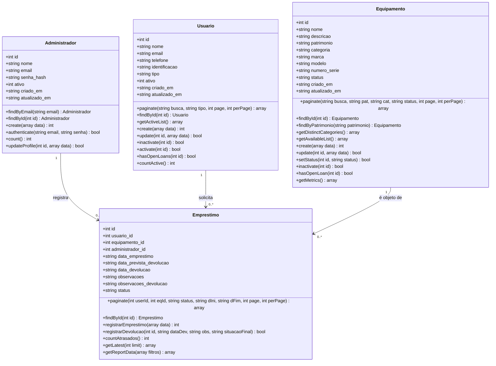
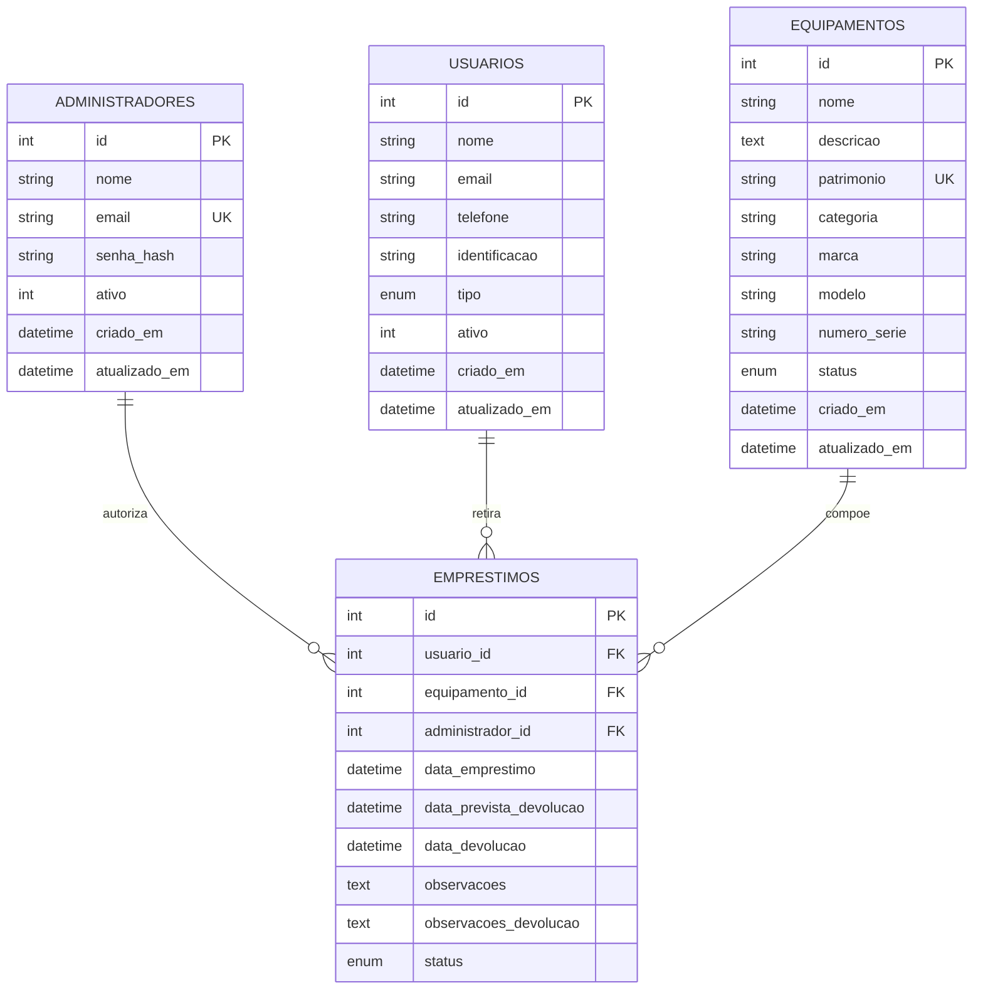
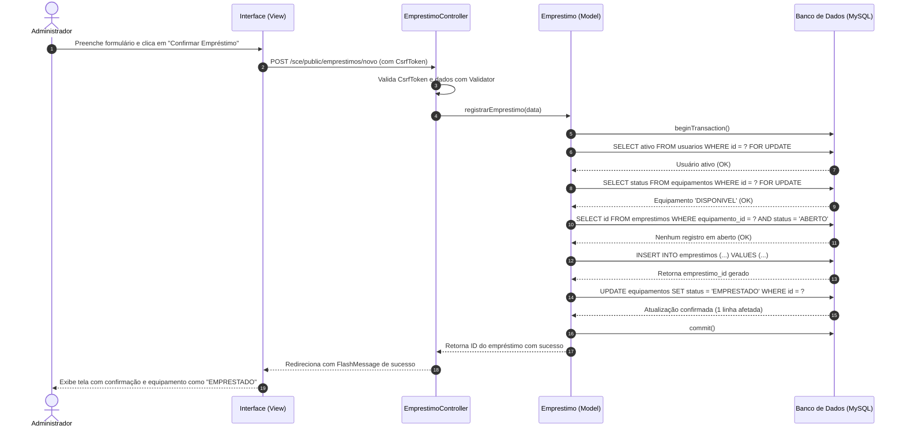

# SCE — Sistema de Controle de Empréstimos de Equipamentos
## Documento 3: Modelagem Técnica e Diagramas do Sistema

---

### 1. Diagrama de Classes (UML / Mermaid)

---

### 2. Modelo Entidade-Relacionamento (MER / DER)

---

### 3. Dicionário de Dados Técnico

| Tabela | Coluna | Tipo | Tam | Nulo | Chave | Descrição Técnica |
| :--- | :--- | :--- | :--- | :--- | :--- | :--- |
| **administradores** | id | INT | 11 | NÃO | PK | Identificador único autoincremento |
| | nome | VARCHAR | 150 | NÃO | - | Nome completo do gestor administrativo |
| | email | VARCHAR | 150 | NÃO | UK | E-mail para autenticação de acesso |
| | senha_hash | VARCHAR | 255 | NÃO | - | Hash criptográfico gerado por BCRYPT |
| | ativo | TINYINT | 1 | NÃO | - | 1 = Ativo, 0 = Inativo |
| | criado_em | DATETIME | - | NÃO | - | Data e hora de criação do cadastro |
| | atualizado_em | DATETIME | - | SIM | - | Timestamp da última atualização |
| **usuarios** | id | INT | 11 | NÃO | PK | Identificador único autoincremento |
| | nome | VARCHAR | 150 | NÃO | - | Nome completo do solicitante |
| | email | VARCHAR | 150 | SIM | - | E-mail de contato do solicitante |
| | telefone | VARCHAR | 20 | SIM | - | Telefone ou WhatsApp de contato |
| | identificacao | VARCHAR | 50 | SIM | - | Matrícula acadêmica ou registro |
| | tipo | ENUM | - | NÃO | - | ALUNO, PROFESSOR, FUNCIONARIO, OUTRO |
| | ativo | TINYINT | 1 | NÃO | - | 1 = Ativo (apto), 0 = Inativo (bloqueado) |
| **equipamentos** | id | INT | 11 | NÃO | PK | Identificador único autoincremento |
| | nome | VARCHAR | 150 | NÃO | - | Descrição/Título do equipamento |
| | descricao | TEXT | - | SIM | - | Detalhes, acessórios e especificações |
| | patrimonio | VARCHAR | 50 | NÃO | UK | Código exclusivo de tombamento patrimonial |
| | categoria | VARCHAR | 100 | SIM | - | Classificação (ex: Notebook, Projetor) |
| | marca | VARCHAR | 100 | SIM | - | Fabricante do item |
| | modelo | VARCHAR | 100 | SIM | - | Modelo técnico do equipamento |
| | numero_serie | VARCHAR | 100 | SIM | - | Serial number de fábrica |
| | status | ENUM | - | NÃO | - | DISPONIVEL, EMPRESTADO, MANUTENCAO, INATIVO |
| **emprestimos** | id | INT | 11 | NÃO | PK | Identificador único autoincremento |
| | usuario_id | INT | 11 | NÃO | FK | Chave estrangeira referenciando `usuarios(id)` |
| | equipamento_id| INT | 11 | NÃO | FK | Chave estrangeira referenciando `equipamentos(id)` |
| | administrador_id| INT | 11 | NÃO | FK | Chave estrangeira referenciando `administradores(id)` |
| | data_emprestimo| DATETIME | - | NÃO | - | Data e hora em que o item foi retirado |
| | data_prevista_devolucao| DATETIME | - | NÃO | - | Prazo estipulado para entrega |
| | data_devolucao| DATETIME | - | SIM | - | Data e hora efetiva de entrega (baixa) |
| | observacoes | TEXT | - | SIM | - | Observações no momento do empréstimo |
| | observacoes_devolucao| TEXT | - | SIM | - | Observações no momento do recebimento |
| | status | ENUM | - | NÃO | - | ABERTO, DEVOLVIDO |

---

### 4. Diagrama de Sequência: Registro de Empréstimo Transacional

